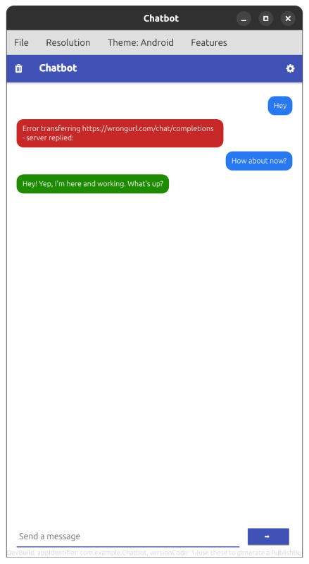

# Chatbot

An OpenAI-compatible LLM chat client written in QML with [Felgo](https://felgo.com) and Qt. It runs on desktop, Android and iOS from a single codebase and works with any server that speaks the OpenAI chat API, including local servers like LM Studio, Ollama or llama.cpp.



## Features

- Chat interface with colored message bubbles and a typing indicator while waiting for the answer
- Works with any OpenAI-compatible API (`/v1/chat/completions`)
- Model picker: fetches the available models from the server's `/models` endpoint, with manual entry as a fallback
- Connection check built in: fetching the model list verifies URL and key in one step
- Visible error handling: failed requests show a red error bubble with the server's message
- Chat history and settings persist across app restarts
- Clear chat button with confirmation dialog

## Getting started

1. Download the [Felgo SDK](https://felgo.com/doc/felgo-installation/) (includes Qt and Qt Creator).
2. Open `CMakeLists.txt` in Qt Creator and build & run the project for your platform.

## Configuration

On first start, open the settings dialog (cog icon in the header) and fill in:

| Setting | Example | Notes |
| --- | --- | --- |
| API base URL | `http://localhost:1234/v1` | Usually ends with `/v1` |
| API key | `gibberish` | Local servers accept anything; required for OpenAI |
| Model | `gpt-oss-20b` | Fetched from the server or typed manually |

The key is entered by the user and stored only on their device nothing sensitive is hardcoded or shipped with the app.

## Project structure

| File | Responsibility |
| --- | --- |
| `qml/Main.qml` | App shell, chat logic and chat persistence |
| `qml/ChatApi.qml` | All HTTP concerns, no UI |
| `qml/ChatView.qml` | Reusable list of chat bubbles |
| `qml/InputBar.qml` | Message input row with send button |
| `qml/SettingsDialog.qml` | API configuration dialog with model dropdown |

## Documentation

A step-by-step tutorial that explains how the app is built, from an empty Felgo project to the finished chat, lives in `doc/index.qdoc`. Build the documentation with:

```sh
cd doc
<path to Qt/Felgo installation>/bin/qdoc chatbot.qdocconf
```

The generated HTML ends up in `build/doc`.

## License

[MIT](LICENSE)
